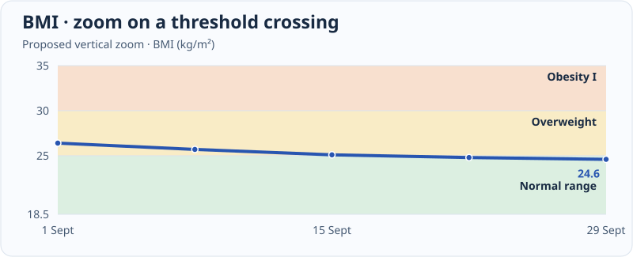
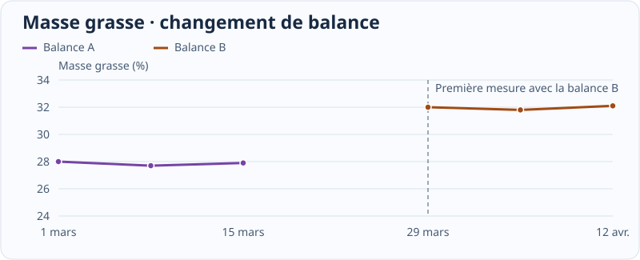

# ÉPI · Visualiser l’évolution du poids et de la composition corporelle

*Recherche et propositions produit · 15 novembre 2026*

## 1. Trois questions à traiter dans l’écran Pesées

- **Quelle est ma dernière mesure ?** Une valeur datée, avec son unité et sa provenance.
- **Dans quel sens ça évolue ?** Les pesées brutes et une tendance identifiée, sur une période choisie.
- **Qu’est-ce qui évolue ensemble ?** Des graphiques alignés dans le temps, avec une échelle et une unité par métrique. Un curseur commun retrouve la même date sur tous les panneaux.

ÉPI dispose déjà des vues Graphique et Tableau, de périodes prédéfinies, d’une sélection par glisser, des modes Brut et Adouci (moyenne centrée sur sept jours) et du choix des séries. Dans le graphique combiné, chaque série est mise à l’échelle séparément et l’ordonnée affichée appartient à la série au premier plan. Les intersections de courbes y sont donc visuelles. Pour comparer le poids, la masse grasse et l’eau, les panneaux synchronisés donneraient à chaque mesure sa propre échelle lisible.

---

## 2. Captures à parcourir

| Logiciel | Motif à retenir pour éPI | Visuels |
| --- | --- | --- |
| **Happy Scale** | Tendance du poids mise en avant, rythme hebdomadaire et objectifs intermédiaires. Proposer le rythme en kg/semaine, avec sa fenêtre de calcul affichée. | [Captures officielles](https://happyscale.com/) |
| **Libra** | Historique du poids et composition dans le même parcours. Reprendre l’accès rapide entre poids et composition et synchroniser les périodes. | [Galerie officielle](https://libra-app.eu/) · [Capture composition](https://libra-app.eu/images/screenshots/cropped.d.png) |
| **MacroFactor** | Ligne claire pour l’évolution du poids et trait violet pour la tendance. Reprendre la hiérarchie visuelle et garder un marqueur distinct pour les jours effectivement mesurés. MacroFactor interpole certains jours dans sa courbe claire. | [Graphiques et méthode](https://help.macrofactorapp.com/dashboard/weight_trend/) |
| **Withings** | Depuis la dernière mesure, ouvrir l’historique détaillé et l’explication de la métrique. Les captures comparatives publiées par un utilisateur illustrent la différence entre points bruts et série lissée. | [Vues détaillées](https://support.withings.com/hc/en-us/articles/39334195353233-Withings-App-Viewing-my-measurements) · [Avant/après](https://support.withings.com/hc/en-us/community/posts/51723297989137-Please-bring-the-full-data-graph-back) · [Captures de composition et de graisse viscérale](https://www.androidcentral.com/apps-software/best-health-fitness-diet-apps-for-hitting-your-goals) |
| **Apple Santé** | Épingler les métriques utiles et passer du résumé au détail. S’appuyer sur les vues mémorisées existantes pour épingler les métriques d’un profil. | [Capture du résumé](https://support.apple.com/en-asia/guide/iphone/iphbb8259c61/27/ios/27) · [Parcours Tendances](https://support.apple.com/en-euro/guide/iphone/iphe3d379c32/ios) |
| **Garmin Connect** | Rattacher les mesures à leur origine, notamment quand le poids est saisi à la main et la composition fournie par une balance. | [Guide des données de poids](https://support.garmin.com/ko-KR/?faq=zS4yMMr7REAVHBPYY6DaZ5) |
| **OMS · Carnet de croissance** | Les courbes pédiatriques illustrent une référence qui évolue avec l’âge. Pour éPI, cela justifie un écran distinct si le suivi pédiatrique entre dans le périmètre. | [Exemple de courbes IMC-pour-l’âge](https://www.who.int/docs/default-source/child-growth/growth-reference-5-19-years/bmi-for-age-%285-19-years%29/cht-bmifa-girls-perc-5-19years.pdf) |

| Tendance du poids · Happy Scale | Composition · Libra |
| --- | --- |
|  |  |

---

## 3. Ce que les études permettent de retenir

- **Le retour visuel a été étudié avec des interventions complètes.** Pacanowski et Levitsky ont testé la pesée fréquente avec retour graphique dans un essai randomisé de deux ans. Steinberg et al. ont combiné pesée, graphique, leçons et retours personnalisés. Un autre essai a étudié la prévention du gain de poids chez de jeunes adultes avec retour graphique. Ces protocoles laissent ouverte la question du meilleur type de courbe ou de l’effet isolé du graphique. Pour éPI, la tendance est une aide de lecture et la fréquence des pesées reste au choix de chacun. [Pacanowski et Levitsky](https://pmc.ncbi.nlm.nih.gov/articles/PMC4443883/) · [Steinberg et al.](https://doi.org/10.1002/oby.20396) · [Essai chez de jeunes adultes](https://pmc.ncbi.nlm.nih.gov/articles/PMC4751025/)
- **Le poids et la composition ont des qualités de mesure différentes.** Dans une comparaison de trois balances connectées avec la DXA, le poids était mieux estimé que la composition. Une étude de quinze appareils à impédance a évalué séparément répétabilité, validité ponctuelle et capacité à suivre un changement. Les performances variaient entre appareils. Indiquer la balance, la méthode et les changements de source sur le graphique. [Étude JMIR](https://mhealth.jmir.org/2021/4/e22487/) · [Étude longitudinale de quinze dispositifs](https://pmc.ncbi.nlm.nih.gov/articles/PMC10404482/)
- **Le protocole compte pour l’impédance.** Hydratation, repas et conditions de mesure peuvent contribuer à une variation. Le lissage rend une série plus facile à lire, tandis qu’une variation persistante peut aussi venir d’un changement de balance ou de formule. La dispersion entre formules décrit leur désaccord. Un intervalle de confiance exige une autre base statistique. [Guide méthodologique de composition corporelle](https://www.sciencedirect.com/science/article/pii/S0002916526000924)
- **Les références dépendent de ce qu’on mesure.** Gallagher et al. ont proposé des plages de pourcentage de graisse dérivées de limites d’IMC. Kelly et al. fournissent des références de composition DXA pour une population américaine. ÉPI utiliserait ces travaux pour documenter d’éventuelles références spécifiques à une méthode et à une population. [Gallagher et al.](https://pubmed.ncbi.nlm.nih.gov/10966886/) · [Kelly et al.](https://pubmed.ncbi.nlm.nih.gov/19753111/)
- **L’échelle et les trous changent la lecture.** Les expériences de Heer et Bostock confortent l’usage de positions sur une échelle commune pour comparer des grandeurs. Les travaux de Song et Szafir montrent que la présentation des données manquantes influence la lecture des séries et la confiance dans les conclusions. Marquer les longues interruptions, conserver les points observés et expliquer toute agrégation. Donner aussi la valeur et le libellé en texte, au clavier comme au toucher. [Heer et Bostock](https://idl.uw.edu/papers/crowdsourcing-graphical-perception) · [Song et Szafir](https://pubmed.ncbi.nlm.nih.gov/30136964/) · [WCAG 2.2](https://www.w3.org/TR/WCAG22/#use-of-color)

---

## 4. Quel graphique pour chaque donnée ?

| Donnée éPI | Vue proposée | Détail à rendre lisible |
| --- | --- | --- |
| **Poids (kg)** | Points bruts fins et tendance épaisse sur le même axe. Ligne d’objectif ou zone de maintien facultative. | Dernière pesée, écart sur la période en kg, rythme lissé en kg/semaine si le recul suffit. Option d’axe resserré, avec ses bornes visibles. |
| **IMC (kg/m²)** | Courbe sur huit bandes de référence adulte. | Seuils en texte, catégorie de la dernière mesure brute et indication d’un changement de taille de référence. |
| **Masse grasse (%)** | Points bruts et tendance, panneau synchronisé avec le poids. | Écart en **points de pourcentage**. Par exemple, de 29 à 27 % donne −2 points. Méthode visible. |
| **Masse grasse (kg)** | Courbe en kg, face à la masse maigre sur un axe du temps commun. | Afficher aussi la proportion au survol. Une variation du poids total peut faire évoluer kg et pourcentage dans des sens différents. |
| **Masse maigre (kg)** | Panneau jumeau de la masse grasse. Au détail d’une pesée, barre empilée graisse + masse maigre si elles proviennent de la même méthode. | La masse maigre comprend notamment eau, muscles et os. Le détail permet de retrouver le poids total. |
| **Indices de masse grasse et maigre (kg/m²)** | Deux courbes dans des panneaux alignés, avec une option d’affichage en kg. | Afficher la taille utilisée. Pour des indices issus d’un même calcul, leur somme correspond à l’IMC. |
| **Eau totale (L et %)** | Commutateur L / % et points bruts disponibles dans les deux cas. | Date, heure, source et écart dans l’unité affichée. Garder une vue distincte pour cette estimation. |
| **Masse musculaire Mi Fit (kg)** | Tendance longue dans Composition, avec les points et le nom de la formule. | Permettre un filtre par balance et éviter le rapprochement automatique avec le muscle squelettique. |
| **Muscle squelettique (kg)** | Panneau séparé, par méthode, avec résumé mensuel exploratoire quand la série est dense. | Conserver l’accès aux valeurs individuelles et montrer le nombre de mesures derrière chaque agrégat. |
| **Masse osseuse estimée (kg)** | Dernière estimation et série longue en détail. | Expliciter le calcul et distinguer l’estimation de masse osseuse de la densité mesurée par DXA. |
| **Protéines estimées (%)** | Série secondaire par méthode, masquée dans la vue initiale. | Préciser qu’il s’agit d’une estimation corporelle et afficher la variation en points. |
| **Score de graisse viscérale** | Points ou paliers selon la granularité du score. | Annoter le modèle ou la formule. Réserver d’éventuels repères à une échelle dont les seuils sont documentés. |
| **Énergie au repos (kcal/j)** | Comparaison des formules dans le détail, avec une méthode choisie pour la tendance. | Nom de l’équation et écart en kcal/j. Garder à part toute éventuelle estimation de dépense quotidienne totale. |
| **Âge métabolique (ans)** | Carte secondaire, éventuellement une série en paliers. | Nom de la formule et unité. Garder une présentation neutre. |
| **Impédance (Ω)** | Série brute dans une vue technique, filtrable par balance. | Horodatage, appareil et absences de signal. Utile pour retrouver l’origine d’un changement d’estimation. |

Certains résultats éPI dépendent seulement du poids, de la taille, de l’âge et du sexe, comme CUN-BAE. D’autres utilisent l’impédance. Les estimations de repos dépendent aussi de l’équation choisie. Aujourd’hui le graphique agrège par moyenne les méthodes disponibles pour une métrique. Une méthode qui apparaît après un changement de balance peut donc déplacer la moyenne. Pour Composition, proposer un choix de méthode dont la disponibilité est explicite et tracer une rupture lorsque la source change. [CUN-BAE](https://pubmed.ncbi.nlm.nih.gov/22179957/) · [Mifflin–St Jeor](https://pubmed.ncbi.nlm.nih.gov/2305711/)

---

## 5. Livré · Les bandes d’IMC

Les bandes sont derrière la grille et les courbes quand l’IMC pilote l’axe. L’axe s’étend au-delà de 40 pour afficher la zone supérieure même quand les mesures sont dans une plage plus resserrée. Les bornes sont calculées sur l’axe de l’IMC et les points hors de cette plage restent visibles par extension de l’axe. La légende dépliable affiche les huit intervalles et indique la catégorie de la dernière mesure brute.

| Seuil en kg/m² | Libellé | Fond |
| --- | --- | --- |
| < 16 | Maigreur sévère | Rouge |
| 16 à < 17 | Maigreur modérée | Orange |
| 17 à < 18,5 | Maigreur légère | Jaune |
| 18,5 à < 25 | Corpulence normale | Vert |
| 25 à < 30 | Surpoids | Jaune |
| 30 à < 35 | Obésité I | Orange |
| 35 à < 40 | Obésité II | Rouge |
| ≥ 40 | Obésité III | Violet |

Les libellés décrivent la classification adulte internationale. « Maigreur sévère » indique une plage d’IMC. Un diagnostic d’anorexie repose sur une évaluation clinique. Le fond est masqué si une pesée affichée concerne un âge connu inférieur à 18 ans. Les historiques sans âge disponible peuvent afficher les repères explicitement libellés « adulte ». Les courbes pédiatriques utilisent l’IMC-pour-l’âge. [OMS, SuRF Report 2, tableau 3.1](https://iris.who.int/bitstream/handle/10665/43190/9241593024_eng.pdf) · [OMS, référence de croissance 5–19 ans](https://www.who.int/tools/growth-reference-data-for-5to19-years/indicators/)

---

## 6. Exemples de graphiques à prototyper

Les quatre maquettes utilisent des données fictives. Elles illustrent les interactions proposées pour éPI.

### Poids · Garder les points bruts et la tendance à l’écran

Le 21 novembre, le poids remonte de **76,4 à 76,7 kg**, tandis que la moyenne continue de baisser. Au toucher d’un point, afficher les deux valeurs sous des libellés distincts, par exemple **Pesée 76,7 kg** et **Moyenne 7 j 76,9 kg**. La moyenne démarre ici au septième jour. Pour les historiques irréguliers, afficher l’effectif de la fenêtre et définir le minimum d’observations avant de dessiner la tendance.

### Composition · Lire le poids, la graisse et la masse maigre ensemble

Le poids est de **78 kg** aux deux extrémités. La masse grasse estimée passe de **22 à 21 kg** (environ **28,2 à 26,9 %**), tandis que la masse maigre estimée passe de **56 à 57 kg**. Un curseur commun permet de lire les trois valeurs à la même date. Dans le panneau Masse grasse, le bouton **kg / %** change l’unité et conserve la période. Une fiche de pesée peut présenter la décomposition **21 kg de graisse + 57 kg de masse maigre = 78 kg** lorsque les valeurs proviennent du même calcul.

### IMC · Lire un franchissement sans perdre les repères

Dans cet exemple, la pesée du **15 septembre (25,1)** est au-dessus de 25 et celle du **22 septembre (24,8)** est en dessous. Le segment indique seulement que le franchissement se situe entre ces deux relevés. En complément de la vue actuelle à huit bandes, proposer **Zoom sur les mesures** et **Voir tous les repères**, avec les bornes affichées et la légende complète disponible dans les deux modes.

### Provenance · Expliquer les ruptures de série

Les estimations tournent autour de **28 %** avec la balance A, puis autour de **32 %** après un changement d’appareil. Interrompre le trait et signaler la première mesure de la balance B. Dans le détail du point, afficher la balance et la formule. Appliquer la même logique à une longue interruption ou à un changement de méthode, avec un libellé adapté.

---

## 7. Ordre de réalisation proposé

1. **Poids lisible au quotidien.** Ajouter « Points + tendance » à côté du brut. Sur les points, afficher la vraie valeur à sa vraie hauteur. Donner un libellé distinct à la moyenne et à l’écart entre première et dernière mesures. Pour le suivi au jour le jour, évaluer une moyenne mobile sur sept jours révolus à partir d’une valeur par jour, et signaler une fenêtre peu renseignée. Garder le détail intrajournalier en vue brute.
2. **Composition synchronisée.** Aligner Poids, Masse grasse et Masse maigre avec un curseur partagé et des unités sur chaque axe. Le toucher ou les flèches déplacent le curseur de pesée en pesée. Si une métrique manque à la date sélectionnée, afficher « aucune mesure » dans son panneau. Tester les vues mobiles sur 30 jours puis sur un an.
3. **Provenance et agrégation.** Afficher la balance, la formule et les changements de source. Pour l’historique long, donner la médiane, l’étendue et l’effectif des périodes renseignées, puis revenir aux points bruts au zoom. Utiliser un espace vide ou des segments explicitement signalés pour les longues interruptions.
4. **Objectifs et contexte au choix.** Ajouter une ligne cible ou une zone de stabilité choisie par profil, des annotations datées et un résumé de période. Donner une couleur neutre aux écarts signés hors contexte d’un objectif. Vérifier les seuils et libellés sur thèmes clair et sombre, au clavier et sur écran tactile.

**Scénario de validation.** Sur un historique de démonstration avec un mois sans mesure, une nouvelle balance et un poids stable, vérifier qu’on peut retrouver la dernière vraie pesée, expliquer un saut de masse grasse et repérer le seuil d’IMC franchi. Répéter avec une seule pesée et avec une métrique absente sur toute la période.
