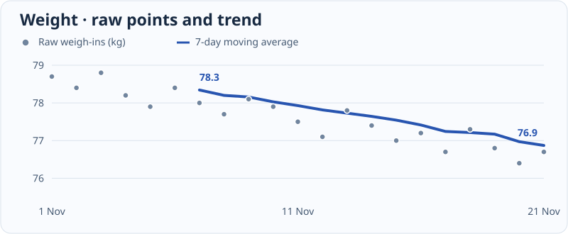
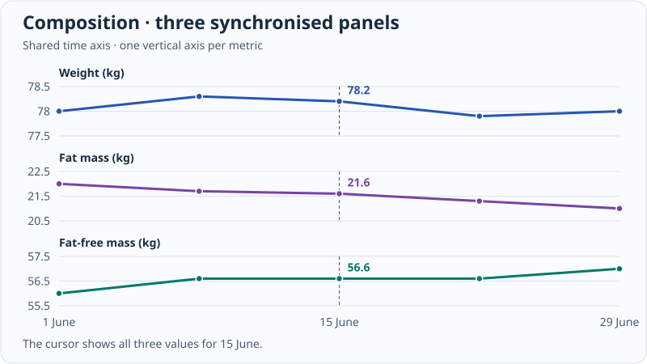

# ÉPI · Visualising changes in weight and body composition

*Research and product proposals · 15 November 2026*

## 1. Three questions for the Weigh-ins screen

- **What is my latest measurement?** A dated value with its unit and source.
- **Which way is it moving?** Raw weigh-ins and an identified trend over a chosen period.
- **What changes together?** Time-aligned charts with a scale and unit for each metric. A shared cursor locates the same date across panels.

ÉPI already has Chart and Table views, preset periods, drag selection, Raw and Trend modes and series selection. Points show raw values in both modes. Trend mode plots a centred seven-day average. In the combined chart, each series is scaled separately and the displayed vertical axis belongs to the foreground series. Curve intersections are therefore visual only. To compare weight, fat mass and water, synchronised panels would give each measurement its own readable scale.

---

## 2. Screenshots to explore

| Software | Pattern to consider for éPI | Visuals |
| --- | --- | --- |
| **Happy Scale** | Prominent weight trend, weekly rate and intermediate goals. Offer kg/week with the calculation window displayed. | [Official screenshots](https://happyscale.com/) |
| **Libra** | Weight history and composition in one flow. Reuse quick access between weight and composition and synchronise periods. | [Official gallery](https://libra-app.eu/) · [Composition screenshot](https://libra-app.eu/images/screenshots/cropped.d.png) |
| **MacroFactor** | Light line for weight change and purple trend. Reuse the visual hierarchy and retain distinct markers for actual measurement days. MacroFactor interpolates some days in its light curve. | [Charts and method](https://help.macrofactorapp.com/dashboard/weight_trend/) |
| **Withings** | Open detailed history and metric explanations from the latest measurement. User-published comparison screenshots illustrate raw points versus smoothed series. | [Detailed views](https://support.withings.com/hc/en-us/articles/39334195353233-Withings-App-Viewing-my-measurements) · [Before/after](https://support.withings.com/hc/en-us/community/posts/51723297989137-Please-bring-the-full-data-graph-back) · [Composition and visceral fat screenshots](https://www.androidcentral.com/apps-software/best-health-fitness-diet-apps-for-hitting-your-goals) |
| **Apple Health** | Pin useful metrics and move from summary to detail. Use existing saved views to pin a profile's metrics. | [Summary screenshot](https://support.apple.com/en-asia/guide/iphone/iphbb8259c61/27/ios/27) · [Trends flow](https://support.apple.com/en-euro/guide/iphone/iphe3d379c32/ios) |
| **Garmin Connect** | Associate measurements with their source, particularly manually entered weight and scale-provided composition. | [Weight data guide](https://support.garmin.com/ko-KR/?faq=zS4yMMr7REAVHBPYY6DaZ5) |
| **WHO · Growth record** | Paediatric curves illustrate references changing with age. This supports a separate screen if paediatric tracking enters éPI's scope. | [Example BMI-for-age curves](https://www.who.int/docs/default-source/child-growth/growth-reference-5-19-years/bmi-for-age-%285-19-years%29/cht-bmifa-girls-perc-5-19years.pdf) |

| Weight trend · Happy Scale | Composition · Libra |
| --- | --- |
|  |  |

---

## 3. What the studies support

- **Visual feedback has been studied within complete interventions.** Pacanowski and Levitsky tested frequent weighing with graphical feedback in a two-year randomised trial. Steinberg et al. combined weighing, charts, lessons and personalised feedback. Another trial studied weight-gain prevention in young adults with graphical feedback. These protocols leave open the best curve type and the isolated effect of the chart. For éPI, trends aid interpretation and weighing frequency remains a personal choice. [Pacanowski and Levitsky](https://pmc.ncbi.nlm.nih.gov/articles/PMC4443883/) · [Steinberg et al.](https://doi.org/10.1002/oby.20396) · [Young adult trial](https://pmc.ncbi.nlm.nih.gov/articles/PMC4751025/)
- **Weight and composition have different measurement qualities.** Comparing three connected scales against DXA found weight better estimated than composition. A study of fifteen impedance devices separately evaluated repeatability, point-in-time validity and ability to track change. Performance varied between devices. Show scale, method and source changes on the chart. [JMIR study](https://mhealth.jmir.org/2021/4/e22487/) · [Longitudinal study of fifteen devices](https://pmc.ncbi.nlm.nih.gov/articles/PMC10404482/)
- **Protocol matters for impedance.** Hydration, meals and measurement conditions can contribute to variation. Smoothing makes a series easier to read, while persistent changes can also reflect a new scale or formula. Spread between formulae describes their disagreement. A confidence interval requires a different statistical basis. [Body composition methodology guide](https://www.sciencedirect.com/science/article/pii/S0002916526000924)
- **References depend on the quantity measured.** Gallagher et al. proposed body fat percentage ranges derived from BMI limits. Kelly et al. provide DXA composition references for a US population. ÉPI would use these studies to document possible method- and population-specific references. [Gallagher et al.](https://pubmed.ncbi.nlm.nih.gov/10966886/) · [Kelly et al.](https://pubmed.ncbi.nlm.nih.gov/19753111/)
- **Scales and gaps change interpretation.** Heer and Bostock's experiments support positions on a common scale for comparing quantities. Song and Szafir show that presenting missing data affects series interpretation and confidence in conclusions. Mark long interruptions, preserve observed points and explain aggregation. Also provide text values and labels, accessible by keyboard and touch. [Heer and Bostock](https://idl.uw.edu/papers/crowdsourcing-graphical-perception) · [Song and Szafir](https://pubmed.ncbi.nlm.nih.gov/30136964/) · [WCAG 2.2](https://www.w3.org/TR/WCAG22/#use-of-color)

---

## 4. Which chart for each metric?

| éPI metric | Proposed view | Detail to make readable |
| --- | --- | --- |
| **Weight (kg)** | Fine raw points and thick trend on one axis. Optional goal line or maintenance zone. | Latest weigh-in, period change in kg, smoothed kg/week rate if history is sufficient. Optional tighter axis with visible bounds. |
| **BMI (kg/m²)** | Curve over adult reference bands relevant to the period. | Text thresholds, latest raw measurement category and indication of reference-height changes. |
| **Body fat (%)** | Raw points and trend in a panel synchronised with weight. | Change in **percentage points**: 29 to 27% is −2 points. Visible method. |
| **Fat mass (kg)** | Curve in kg alongside fat-free mass on a common time axis. | Also show percentage on hover. Total-weight changes can move kg and percentage in opposite directions. |
| **Fat-free mass (kg)** | Twin panel to fat mass. In weigh-in details, stacked fat + fat-free mass bar if from the same method. | Fat-free mass includes water, muscle and bone. Details reconstruct total weight. |
| **Fat and fat-free mass indices (kg/m²)** | Two curves in aligned panels, with an option to display kg. | Show height used. Indices from the same calculation sum to BMI. |
| **Total body water (L and %)** | L / % switch with raw points in both modes. | Date, time, source and change in the displayed unit. Keep a distinct view for this estimate. |
| **Mi Fit muscle mass (kg)** | Long-term Composition trend with points and formula name. | Allow filtering by scale and avoid automatic equivalence with skeletal muscle. |
| **Skeletal muscle (kg)** | Separate panel per method, with exploratory monthly summaries for dense series. | Retain individual values and show measurement counts behind aggregates. |
| **Estimated bone mass (kg)** | Latest estimate and detailed long-term series. | Explain calculation and distinguish estimated bone mass from DXA-measured density. |
| **Estimated protein (%)** | Secondary series per method, hidden initially. | Explain that this is a body estimate and show changes in points. |
| **Visceral fat score** | Points or steps according to score granularity. | Annotate model or formula. Use possible reference markers only on scales with documented thresholds. |
| **Resting energy (kcal/day)** | Compare formulae in details, with one selected for the trend. | Equation name and difference in kcal/day. Keep any total daily expenditure estimate separate. |
| **Metabolic age (years)** | Secondary card, possibly a stepped series. | Formula name and unit. Keep presentation neutral. |
| **Impedance (Ω)** | Raw series in a technical view, filterable by scale. | Timestamp, device and missing signals. Useful for tracing an estimate change. |

Some éPI results, such as CUN-BAE, depend only on weight, height, age and sex. Others use impedance. Resting estimates also depend on the chosen equation. Currently, the chart averages available methods per metric. A method appearing after a scale change can therefore shift the average. For Composition, offer method selection with explicit availability and a break when the source changes. [CUN-BAE](https://pubmed.ncbi.nlm.nih.gov/22179957/) · [Mifflin–St Jeor](https://pubmed.ncbi.nlm.nih.gov/2305711/)

---

## 5. Delivered · BMI bands

Bands sit behind the grid and curves when BMI controls the axis. The axis shows at least three bands. A series entirely in the normal range also shows mild thinness and overweight. For a series spanning several bands, a neighbour is added if a value passes the midpoint of the boundary band in that direction. If another band is needed to reach the minimum, the nearest completes the view. Scaling considers raw measurements and the displayed curve. The expandable legend shows all eight intervals and the latest raw measurement's category.

| Threshold in kg/m² | Label | Background |
| --- | --- | --- |
| < 16 | Severe thinness | Red |
| 16 to < 17 | Moderate thinness | Orange |
| 17 to < 18.5 | Mild thinness | Yellow |
| 18.5 to < 25 | Normal range | Green |
| 25 to < 30 | Overweight | Yellow |
| 30 to < 35 | Obesity I | Orange |
| 35 to < 40 | Obesity II | Red |
| ≥ 40 | Obesity III | Purple |

Labels describe the international adult classification. “Severe thinness” indicates a BMI range. Anorexia diagnosis requires clinical assessment. Backgrounds are hidden if a displayed weigh-in has a known age below 18. Histories without age information may display references explicitly labelled “adult”. Paediatric curves use BMI-for-age. [WHO, SuRF Report 2, table 3.1](https://iris.who.int/bitstream/handle/10665/43190/9241593024_eng.pdf) · [WHO growth reference, ages 5–19](https://www.who.int/tools/growth-reference-data-for-5to19-years/indicators/)

---

## 6. Example charts to prototype

The four mock-ups use fictional data to illustrate proposed éPI interactions.

### Weight · Keep raw points and trend visible

On 21 November, weight rises from **76.4 to 76.7 kg** while the average keeps falling. Tapping a point should show distinct labels, such as **Weigh-in 76.7 kg** and **7-day average 76.9 kg**. Here the average starts on day seven. For irregular histories, show the window count and define minimum observations before drawing a trend.

### Composition · Read weight, fat and fat-free mass together

Weight is **78 kg** at both ends. Estimated fat mass changes from **22 to 21 kg** (about **28.2 to 26.9%**), while estimated fat-free mass changes from **56 to 57 kg**. A shared cursor reads all three on the same date. In the Fat mass panel, **kg / %** changes units while preserving the period. Weigh-in details can show **21 kg fat + 57 kg fat-free mass = 78 kg** when values come from the same calculation.

### BMI · Read a threshold crossing without losing context

Here the **15 September (25.1)** weigh-in is above 25 and **22 September (24.8)** is below. The segment indicates only that crossing lies between the two records. Automatic framing shows normal range, overweight and obesity I. This third band is the nearest to either series extreme among hidden bands. **Show all references** could reveal all eight at once.

### Provenance · Explain series breaks

Estimates are around **28%** with scale A, then **32%** after changing device. Break the line and mark scale B's first measurement. Show scale and formula in point details. Apply the same logic to long interruptions and method changes, with suitable labels.

---

## 7. Proposed implementation order

1. **Readable everyday weight.** In Trend mode, show the average beside the weigh-in in tooltips and distinguish its change from the first-to-last measurement difference. For daily tracking, evaluate a moving average over seven completed days using one value per day and flag sparse windows. Keep intraday detail in Raw view.
2. **Synchronised composition.** Align Weight, Fat mass and Fat-free mass with a shared cursor and units on each axis. Touch or arrow keys move between weigh-ins. If a metric is missing on the selected date, show “no measurement” in its panel. Test mobile views over 30 days and a year.
3. **Provenance and aggregation.** Show scale, formula and source changes. For long histories, provide median, range and count for populated periods, returning to raw points on zoom. Use gaps or explicitly marked segments for long interruptions.
4. **Optional goals and context.** Add a profile-selected target line or stability zone, dated annotations and period summary. Use neutral colours for signed differences outside a goal context. Check thresholds and labels in light and dark themes, with keyboard and touch.

**Validation scenario.** Using demonstration history with a month without measurements, a new scale and stable weight, check that users can find the latest actual weigh-in, explain a body fat jump and identify a crossed BMI threshold. Repeat with one weigh-in and a metric absent throughout the period.
